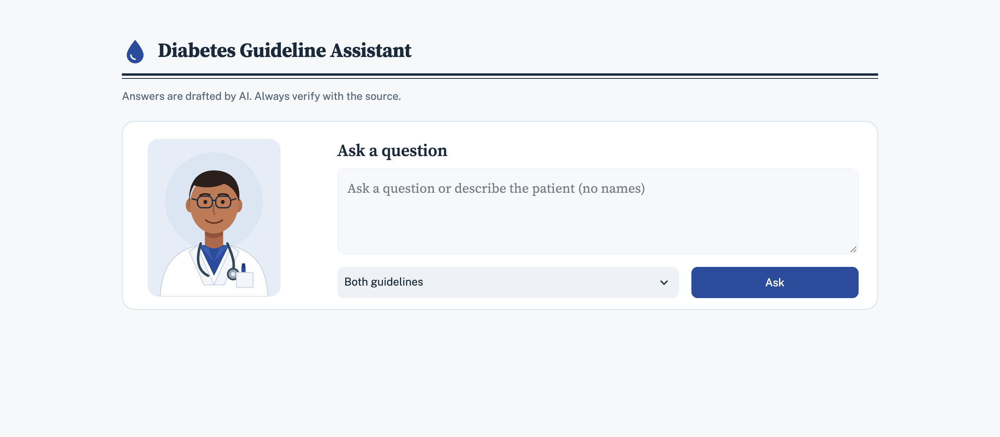

# Diabetes Guideline Assistant (RAG)



Answers clinical questions about type 2 diabetes **only** from two guideline sets, and shows the exact
source (guideline, document, page, quote) for every recommendation:

- **ADA 2026**: American Diabetes Association, *Standards of Care in Diabetes—2026* (sections 2, 4, 6, 8, 9, 10, 11, 12 + Summary of Revisions), in `guidelines/ada/`
- **ICMR**: *ICMR Guidelines for Management of Type 2 Diabetes 2018* + ICMR Standard Treatment Workflows (T2DM, CKD, diabetic foot, retinopathy, hypertension), in `guidelines/icmr/`

Use made-up patient examples only. Never enter real patient data: the question and the retrieved
guideline excerpts are sent to the LLM API.

## How it works

```
PDFs ──ingest.py──► page-level chunks (+ markdown tables) ──► FAISS index + chunks.json
question ──► small LLM writes 2–4 focused search queries (e.g. "SGLT2 inhibitor in HFpEF")
         ──► for each query: BM25 (keyword, top 8) + FAISS (semantic, top 8) ──RRF 0.5/0.5──► top 6
         ──► fuse all queries; "Both guidelines" keeps 5 ADA + 3 ICMR chunks (8 total)
         ──► LLM (temperature 0, JSON) ──► RapidFuzz check that each quote is on the cited page
```

| File | What it does |
| --- | --- |
| `ingest.py` | Reads each PDF page with PyMuPDF, detects section headings, adds pdfplumber tables as markdown, splits each page into ~900-char chunks (150 overlap, never across pages), skips reference lists, embeds with `BAAI/bge-small-en-v1.5`, saves FAISS + `chunks.json` to `index/` |
| `retrieval.py` | BM25Retriever + FAISS merged by EnsembleRetriever (Reciprocal Rank Fusion); multi-query search with separate ADA/ICMR slots; filter: both / ADA / ICMR |
| `llm.py` | Query rewriting + answer prompt; OpenAI-compatible client (Gemini, OpenRouter, ...) configured from `.env`. With only `GEMINI_API_KEY` set it uses `gemini-3.5-flash` for answers and `gemini-flash-lite-latest` for search queries (separate free quotas; override with `MODEL_NAME` / `REWRITE_MODEL`). |
| `verify.py` | RapidFuzz `partial_ratio ≥ 90`: is the quote really on the cited page? |
| `pipeline.py` | Ties retrieval → LLM → verification together |
| `app.py`, `style.css` | Streamlit web page (clinical letterhead design); theme and fonts in `.streamlit/config.toml` |
| `assets/doctor.svg` | Doctor illustration next to the question box. Put your own photo at `assets/doctor.jpg` (or `.png`) to replace it. |
| `run_tests.py` | Runs the 5 test questions from the command line |

## Setup

Requires Python 3.10+.

```bash
git clone https://github.com/priyanshusky0/RAG_DOCTOR.git
cd RAG_DOCTOR
python3 -m venv .venv
source .venv/bin/activate
pip install -r requirements.txt
```

Add the guideline PDFs. They are not included in this repository (the ADA Standards of Care are
copyrighted), so download them and place them as listed in [`guidelines/README.md`](guidelines/README.md).

Add your API key:

```bash
cp .env.example .env
# edit .env: set OPENAI_API_KEY (and switch to the OpenRouter block if you prefer)
# or simply put one line in .env:  GEMINI_API_KEY=your-key
```

`.env` is in `.gitignore`. Never put keys in the code.

Build the index (run once, about 2 minutes; downloads the embedding model on first run):

```bash
python ingest.py
```

Start the app:

```bash
streamlit run app.py
```

Optional, to run the test questions in the terminal:

```bash
python run_tests.py
```

Open http://localhost:8501. The app does not reload when you edit code (the file watcher is off to keep
the log clean), so stop it with Ctrl+C and start it again after changes.

## Notes and limits

- Why multi-query search: a patient description mixes several issues (eGFR, heart failure, HbA1c),
  so one combined search matched none of the specific recommendations. On 12 expected passages across
  5 test questions, plain search found 4; focused queries + separate ADA/ICMR slots found 8.
  A local cross-encoder reranker was also tried and did not help (the passages were not in its pool).
- Each question uses 2 AI requests (1 small rewrite + 1 answer). Gemini's free tier has a daily
  limit per model; enable billing for regular use.

- Page numbers are **PDF viewer page numbers** (page 1 = first page of that PDF file), not the
  journal page numbers printed on ADA pages (e.g. "S183").
- "⚠ not verified" means the quote could not be found on the cited page, so check that citation by hand.
- ICMR 2018 pages 1, 6 and 7 contain almost no text (cover/images) and are not searchable.
- The ICMR Standard Treatment Workflows are one-page posters; their text order can be jumbled.
